# GitLaTeX — Architecture and Control-Flow Charts

This document describes how GitLaTeX works, in a set of flowcharts. It is
written for engineers who are new to the codebase. Each diagram covers one
subsystem, and file paths point to where the code lives. The diagrams are
written in [Mermaid](https://mermaid.js.org/), which GitHub, VS Code and most
Markdown viewers render.

**Contents**

1. [System overview](#1-system-overview)
2. [Server startup](#2-server-startup)
3. [HTTP request dispatch](#3-http-request-dispatch)
4. [Client boot and opening a project](#4-client-boot-and-opening-a-project)
5. [Edit → save → auto-compile loop](#5-edit--save--auto-compile-loop)
6. [Compile: choosing a backend](#6-compile-choosing-a-backend)
7. [Local TeX build loop (server)](#7-local-tex-build-loop-server)
8. [In-browser TeX build loop (WebAssembly worker)](#8-in-browser-tex-build-loop-webassembly-worker)
9. [Engine and package-shelf proxy cache](#9-engine-and-package-shelf-proxy-cache)
10. [Git: push and pull with rebase](#10-git-push-and-pull-with-rebase)
11. [SyncTeX: source ↔ PDF](#11-synctex-source--pdf)
12. [Live collaboration](#12-live-collaboration)
13. [Build and release pipeline](#13-build-and-release-pipeline)

---

## 1. System overview

GitLaTeX has three parts:

- a **local Python/Flask server** (`gitlatex/`) that owns the disk, Git and local TeX
- a **React single-page app** (`web/`, built into `gitlatex/ui/`) that runs in the browser
- an optional **Cloudflare Worker** (`collab-worker/`) that relays live-collaboration edits

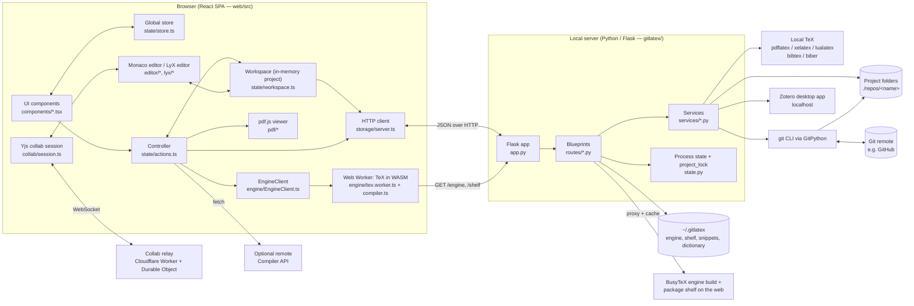

**Key design points**

- The server holds one *current project* (`state.current_repo_path`). Opening a
  project selects it for every later file, compile, Git and SyncTeX route.
- Every route that changes project files is serialised by a single re-entrant
  lock, `state.project_lock`, applied by the `@with_project_lock` decorator
  (`gitlatex/http.py`). This covers Git, compiles, PDF saves and writes.
- The browser keeps the whole project in memory (`Workspace`) and writes changes
  back to disk through a serial queue, so Git always sees what the editor shows.

---

## 2. Server startup

Entry point: `gitlatex` → `gitlatex/server.py:main`.

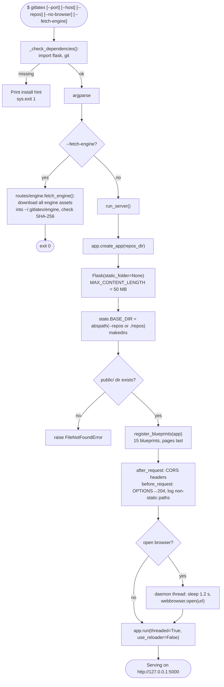

---

## 3. HTTP request dispatch

The routes are split into blueprints, one per UI area (`gitlatex/routes/__init__.py`).
`pages` is registered **last** because its catch-all `/<path>` route serves the SPA.

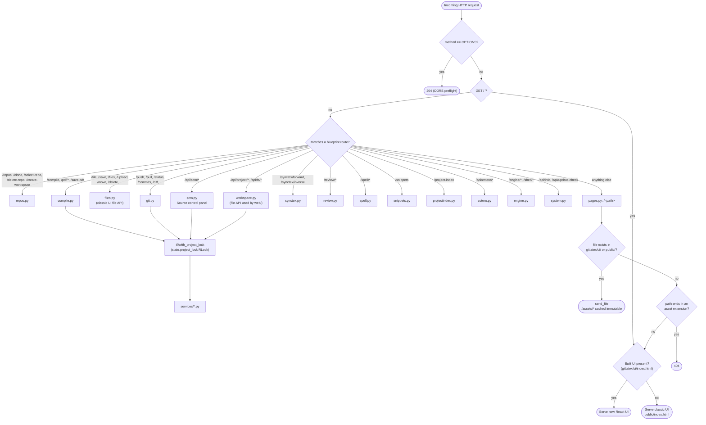

The **classic UI** (`gitlatex/public/`, plain JS) is still served at `/classic`,
and at `/` when the React build is missing. The rest of this document describes
the React UI in `web/`.

---

## 4. Client boot and opening a project

Code: `web/src/main.tsx` → `App.tsx` → `state/actions.ts` (`boot`, `openProject`).

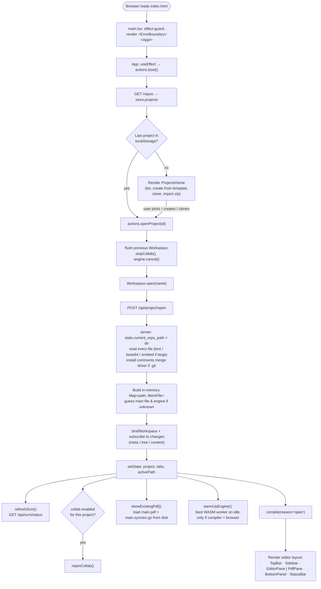

---

## 5. Edit → save → auto-compile loop

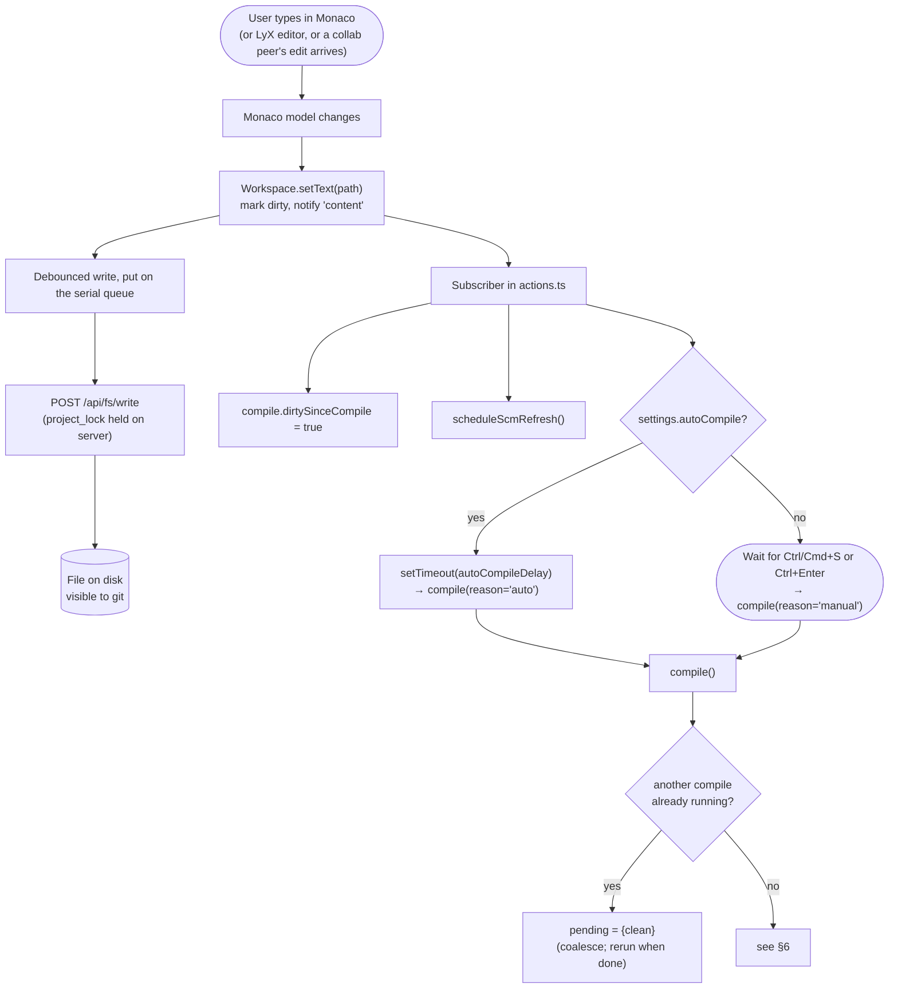

Other editor services that run while typing (all in `web/src/editor/`):
spell checking (`POST /spell/check`), autocomplete from labels and BibTeX keys,
snippets (`/snippets`), review comments (`/review/*`), outline, Vim/VimTeX
key maps, and conflict-marker tools.

---

## 6. Compile: choosing a backend

Code: `web/src/state/actions.ts` (`compile`, `resolveCompiler`, `buildLocally`,
`buildInBrowser`, `buildViaApi`).

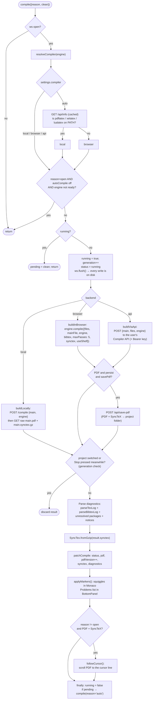

**Cancelling.** In the browser, `EngineClient.cancel()` terminates the worker,
because a TeX run in WebAssembly cannot be interrupted, and boots a new one from
the cache. Local and API builds cannot be stopped. `generation++` makes the UI
ignore their results.

---

## 7. Local TeX build loop (server)

Code: `gitlatex/routes/compile.py` → `gitlatex/services/latex.py:run_latex_build`.
The rules are the same as latexmk's: a pass is repeated only while the files TeX
reads back change.

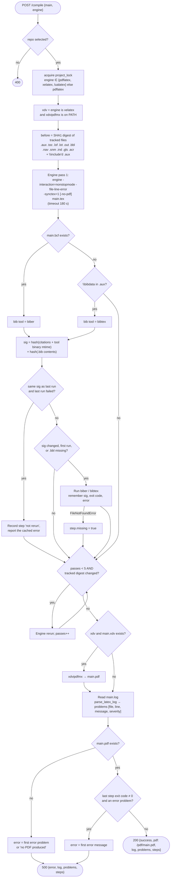

---

## 8. In-browser TeX build loop (WebAssembly worker)

Code: `web/src/engine/` — `EngineClient.ts` (UI thread) ⇄ `tex.worker.ts` →
`compiler.ts` (`TexCompiler`) → `busytex-host.ts` (BusyTeX WASM: pdfTeX, XeTeX,
bibtex8, makeindex, xdvipdfmx).

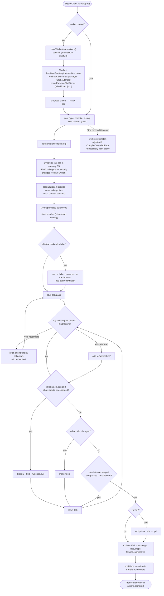

---

## 9. Engine and package-shelf proxy cache

The WASM engine (~190 MB) is not part of the Python package. The server
downloads it on first use, checks it against the manifest, and serves it from
then on (`gitlatex/routes/engine.py`).

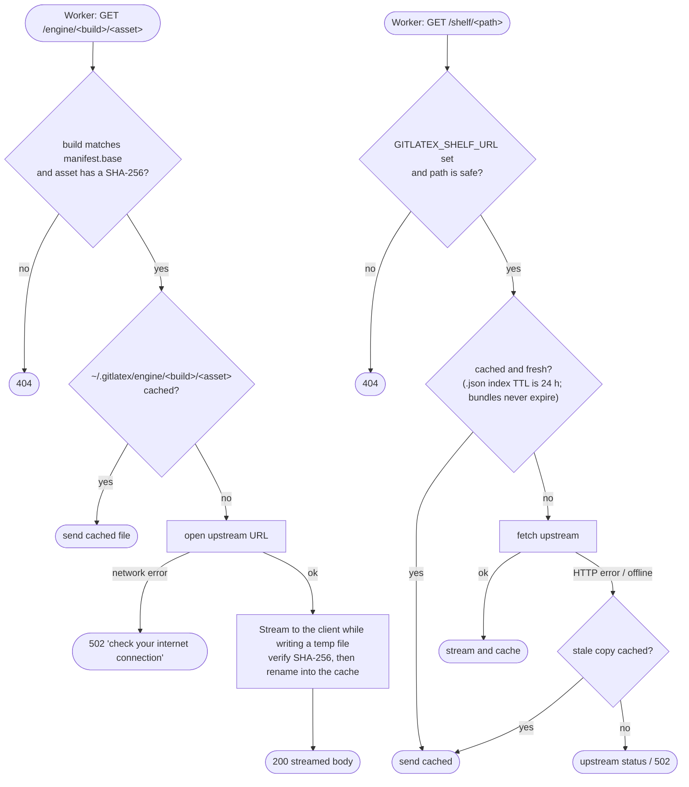

---

## 10. Git: push and pull with rebase

Code: `gitlatex/routes/git.py` (toolbar push/pull), `gitlatex/routes/scm.py` +
`services/scm.py` (Source control panel), and `services/sync.py` (shared
pull/push logic). Design notes: [docs/sync-and-conflicts.md](sync-and-conflicts.md).

### Push

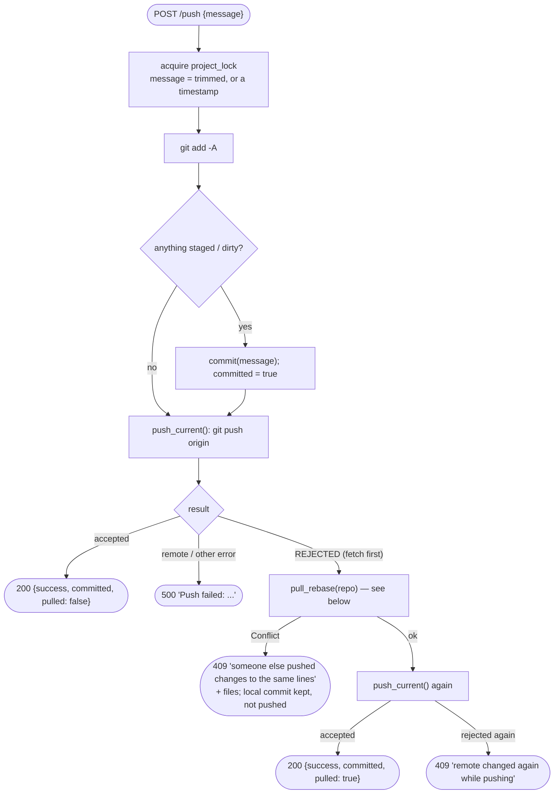

### Pull (`services/sync.py:pull_rebase`)

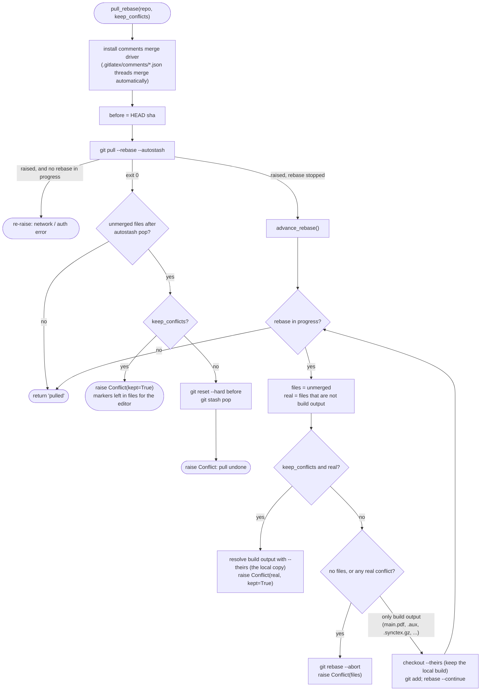

The editor's **Source control panel** (`/api/scm/*`) uses the same functions
with `keep_conflicts=True`. Conflicts are then left in the files, and the user
settles them in the editor with *Accept current / incoming* (`/api/scm/resolve`),
*Mark resolved*, or *Abort*.

---

## 11. SyncTeX: source ↔ PDF

The React UI parses the `.synctex.gz` produced by the last build **in the
browser** (`web/src/latex/synctex.ts`). The classic UI uses the server's pure-Python
reader instead (`/synctex/forward|inverse` → `services/synctex_reader.py`).

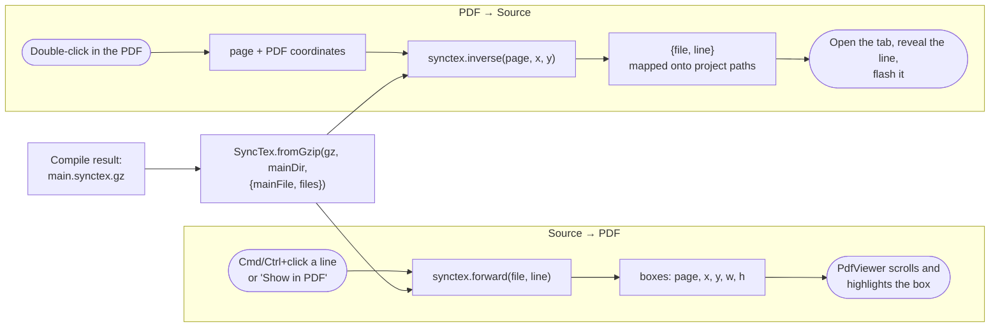

---

## 12. Live collaboration

Optional, per project. Code: `web/src/collab/` and `collab-worker/src/index.ts`.
Only text is relayed. Each participant still writes, compiles and commits on
their own machine.

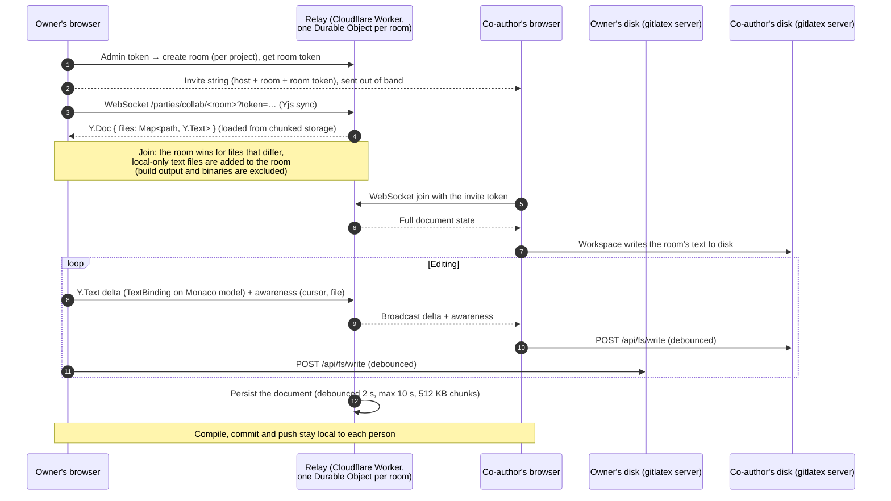

---

## 13. Build and release pipeline

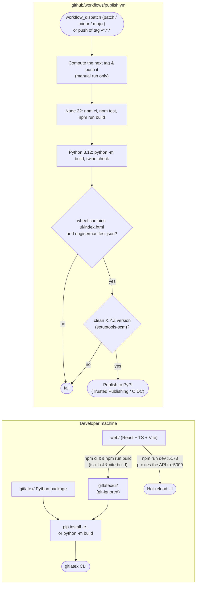

---

## Appendix: where to look

| Concern | Server (`gitlatex/`) | Client (`web/src/`) |
| --- | --- | --- |
| Entry point | `server.py`, `app.py` | `main.tsx`, `App.tsx` |
| Global state | `state.py` | `state/store.ts`, `state/actions.ts` |
| Project files | `routes/workspace.py`, `routes/files.py`, `services/paths.py` | `state/workspace.ts`, `storage/server.ts` |
| Compile | `routes/compile.py`, `services/latex.py` | `engine/*`, `latex/log-parser.ts` |
| Git | `routes/git.py`, `routes/scm.py`, `services/sync.py`, `services/scm.py` | `components/GitPanel.tsx`, `editor/conflicts.ts` |
| Review comments | `routes/review.py`, `services/comments*.py` | `editor/review.ts`, `components/ReviewPanel.tsx` |
| SyncTeX | `routes/synctex.py`, `services/synctex*.py` | `latex/synctex.ts`, `pdf/*` |
| Spell / snippets / Zotero | `services/spell.py`, `snippets.py`, `zotero.py` | `editor/spell.ts`, `editor/snippets.ts` |
| LyX-style editor | — | `lyx/*` (tex-import ⇄ DOM model ⇄ tex-export) |
| Live collaboration | — | `collab/*` + `collab-worker/` |
| Tests | `tests/*.py` (unittest) | `web/tests/unit` (vitest), `web/tests/e2e` |
